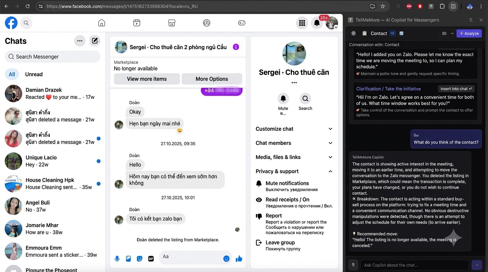
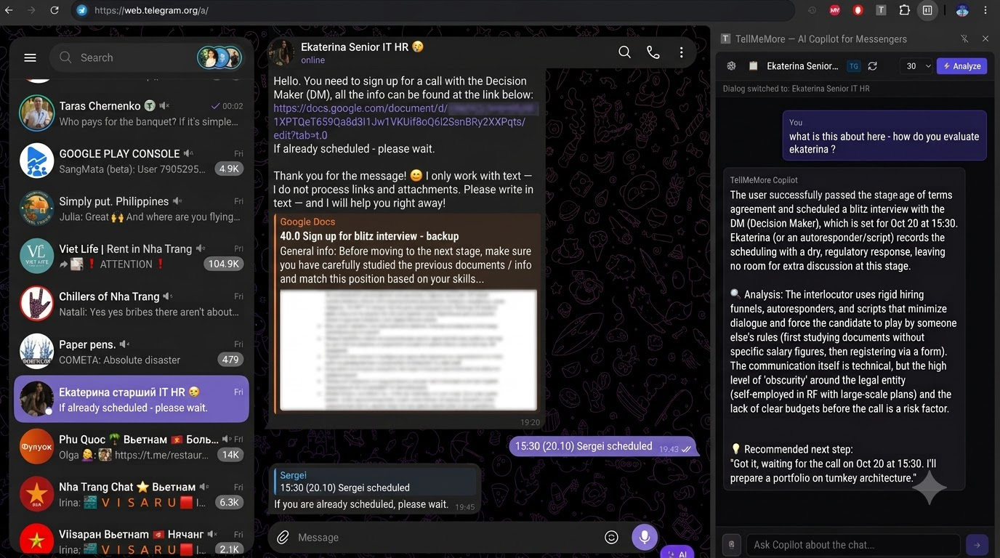
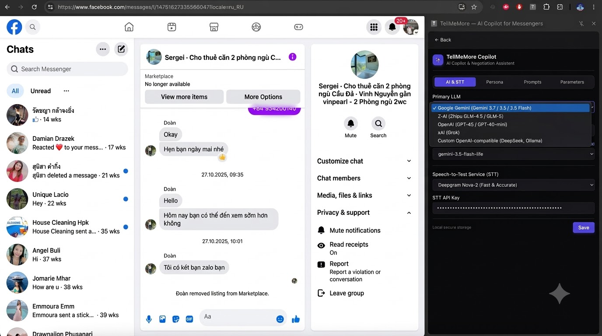
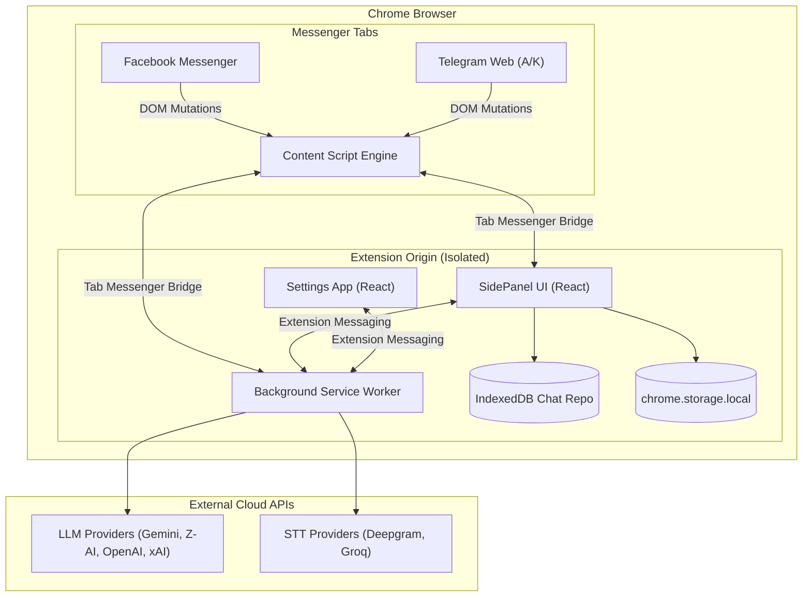

# ✨ TellMeMore Copilot

> **Universal Real-Time AI Copilot & Strategic Negotiation Assistant for Web Messengers**  
> *Supports Facebook Messenger, Telegram Web (A & K), and more.*

[](LICENSE)
[](#)
[](https://www.typescriptlang.org/)
[](https://react.dev/)
[](https://tailwindcss.com/)
[](#-multi-language-localization)

---

## 📸 Screenshots

| Facebook Messenger + Copilot SidePanel | Telegram Web + Copilot SidePanel |
| :---: | :---: |
|  |  |

| AI & Speech-to-Text Provider Settings |
| :---: |
|  |

---

## 🌟 Key Features

### 1. 🛡️ Real-Time Tactical Manipulation Detection
- Automatically detects psychological tactics: guilt-tripping, gaslighting, artificial urgency, false scarcity, passive aggression, shifting goalposts, and appeal to pity.
- Displays a clear **Risk Score (%)** with concise explanations and actionable counter-moves.

### 2. ⚡ Strategic "Sandwich" Reply Generator
- Proposes multi-angle tactical replies (e.g. *Boundary Assertion*, *De-escalation*, *Strategic Counter-Offer*).
- **1-Click Insert**: Transfers any selected response directly into the messenger input field (`contenteditable` or `textarea`).

### 3. 🌐 Multi-Platform Messenger Support
- **Facebook Messenger** (`facebook.com/messages`) — Dynamic chat mutation observers and media inspection.
- **Telegram Web** (`web.telegram.org/a` & `web.telegram.org/k`) — Full thread detection, reactive message syncing, and input integration.
- Extensible `MessengerAdapter` architecture to plug in WhatsApp Web, Slack, Discord, and others.

### 4. 🧠 Multi-LLM Provider Engine
- **Google Gemini**: Gemini 3.7 Flash, Gemini 3.5 Flash, Gemini 2.5 Flash.
- **Z-AI**: Zhipu GLM-4.5 / GLM-5.
- **OpenAI**: GPT-4o, GPT-4o-mini.
- **xAI**: Grok Beta.
- **Custom OpenAI-compatible**: Connect local Ollama, DeepSeek, vLLM, or LM Studio instances.
- **Auto-Fetch Models**: Query live active models directly from your provider via 1-click button.

### 5. 🎙️ Voice Speech-to-Text (STT) Copilot
- Ask Copilot questions out loud with 1-click audio recording.
- Integrates with **Deepgram Nova-2**, **Groq Whisper Turbo**, and **OpenAI Whisper**.

### 6. 🎨 Granular UI Customization & Typography
- **Typography Presets**: Font sizes (*Compact 11px*, *Normal 12px*, *Large 13.5px*, *Huge 15px*) and font weights (*Regular 400*, *Medium 500*, *SemiBold 600*).
- **Theme Palette Presets**: Indigo, Emerald, Amber, Rose, Cyan, Minimalist Mono, and **Custom Color Picker** with hex input.
- **Ultra-Minimalist Mode**: Compact header, hidden decorative badges for distraction-free deep work.
- **Live Theme Sync**: Instant updates across the UI without page reloads using reactive storage observers.

### 7. 🌍 Automatic 6-Language Localization
- Auto-detects system and browser language:
  - 🇬🇧 English (`en`)
  - 🇷🇺 Russian (`ru`)
  - 🇵🇱 Polish (`pl`)
  - 🇪🇸 Spanish (`es`)
  - 🇩🇪 German (`de`)
  - 🇫🇷 French (`fr`)
- Manual language override available in Parameters tab.

### 8. 🔒 Zero-Cloud Local Privacy
- **Strictly Local**: API keys, contact dossiers, and chat histories are stored exclusively in your browser's private storage (`chrome.storage.local` and `IndexedDB`).
- **No Telemetry**: No third-party tracking or middleman servers.

---

## 🏗️ Architecture & SOLID Principles



### Clean Architecture Layers:
- **`src/core/`**: Pure entities, domain types, interfaces (`MessengerAdapter`, `LLMProvider`, `STTProvider`), prompt templates, and localization.
- **`src/adapters/`**: Isolated messenger implementations (`FacebookAdapter`, `TelegramAdapter`, `TelegramKAdapter`).
- **`src/services/`**: Infrastructure-free business logic (`RAGEngine`, `AudioRecorder`, `IndexedDBChatRepository`).
- **`src/infra/`**: Messaging bridge, timeouts, provider API clients.
- **`src/ui/`**: Minimalist React components (`CopilotApp`, `SettingsApp`).

---

## 🚀 Installation & Getting Started

### Prerequisites
- Node.js 18+ and `npm`
- Google Chrome, Chromium, or Brave

### Build from Source
```bash
# 1. Clone repository
git clone https://github.com/s3rfdev/TellMeMore-Extension.git
cd TellMeMore-Extension

# 2. Install dependencies
npm install

# 3. Build production bundle (Manifest V3)
npm run build
```

### Load in Chrome
1. Open Google Chrome and navigate to `chrome://extensions/`.
2. Toggle **Developer mode** in the top right corner.
3. Click **Load unpacked** and select the `dist/` directory inside this project.
4. Pin **TellMeMore** in your toolbar.
5. Open Facebook Messenger (`https://www.facebook.com/messages`) or Telegram Web (`https://web.telegram.org/k/` or `https://web.telegram.org/a/`).
6. Click the extension icon to open the **Copilot SidePanel**!

---

## ⚙️ Configuration

1. Click the **⚙️ Settings** icon in the top left of the SidePanel.
2. In the **AI & STT** tab:
   - Select your LLM provider (*Google Gemini*, *Z-AI*, *OpenAI*, *xAI*, or *Custom*).
   - Enter your personal API key.
   - Click **⚡ Fetch active models from server** to choose your desired model.
   - (Optional) Configure Deepgram or Groq for voice transcription.
3. In the **UI & Theme** tab:
   - Select your preferred font size, weight, and color palette.
   - Toggle **Ultra-minimalist mode** for a distraction-free view.
4. Click **Save** — all settings are saved securely on your device.

---

## 🛡️ Security & Privacy Notice

TellMeMore is engineered with strict privacy principles:
- **Zero Remote Middleware**: Direct client-to-API communication with your configured providers.
- **Isolated Storage**: Local chat caches never leave your browser sandbox.
- **No Key Leaks**: Local secrets files are ignored by git by default (`keys.local.json`, `.env*`).

---

## 📄 License

This project is open source and available under the [MIT License](LICENSE).
